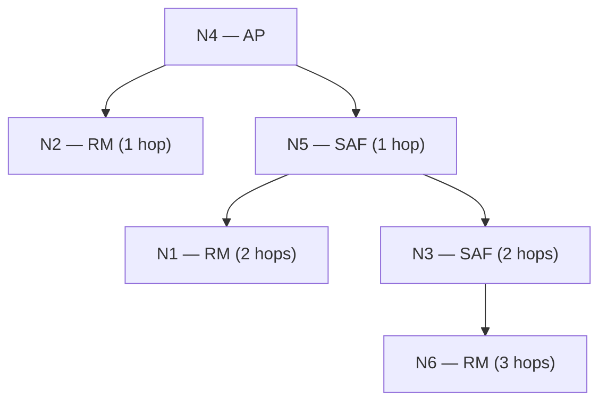

# Network Fault Management in a 900 MHz FHSS Relay Backhaul

| Field       | Value                                                                                   |
| ----------- | --------------------------------------------------------------------------------------- |
| Author      | Fernando Dantas — PUC-PR, CISEI Lab                                                     |
| Execution   | 2026-11-19                                                                              |
| Version     | 0.3 — draft                                                                             |
| Status      | Research questions defined; characterization campaigns complete; fault campaigns planned |
| Environment | Physical (radio bench) with containerized traffic generation                            |

---

## 1. Research definition

### 1.1 Context

Distribution automation reaches reclosers and remote-controlled switches through private
radio backhauls. The supervisory control and data acquisition (SCADA) master polls these
devices and sends commands over the same channel; when a configured response timeout
expires for the configured number of retries, the master declares a communication failure
for the device [CEPEL2020]. From that instant the operator loses supervision and remote
control of that point of the feeder.

The radio network has its own management plane: radio telemetry collected by the network
operations centre, independently of the SCADA traffic. Fault management, in the sense of
the management functions of ITU-T M.3400 [ITUM3400], comprises detecting a fault,
localizing it, and reporting it as an alarm. The research addresses this function for a
frequency-hopping spread-spectrum (FHSS) backhaul organized as a tree of store-and-forward
relays, in which a single degraded hop affects every device beyond it.

### 1.2 Research questions

- **RQ1 — Observability.** Which fault classes of the relay tree produce a measurable
  signature in the management telemetry available from the radios, and which hops and
  directions remain unobserved?
- **RQ2 — Timeliness and cost.** For each observable fault class, what is the detection
  delay of threshold-based detection at a given telemetry collection interval, what is
  its false-alarm rate in fault-free operation, and what collection load does it impose?
- **RQ3 — Application horizon.** Is the fault detected and reported by the network
  management plane before the SCADA application declares communication failure for the
  affected devices?
- **RQ4 — Localization.** Can a detected fault be attributed to a specific hop or node of
  the tree from the telemetry and the known topology, given the observation constraints
  of section 3.3?

### 1.3 Scope

The scope is the radio backhaul: detection, localization to a hop or node of the tree,
and alarm reporting. The gateways and endpoint networks attached to the remote radios are
represented only through the traffic they offer to the backhaul; faults within them are
outside this scope. Automated
remediation, prediction of future faults, and capacity benchmarking of the radio product
are outside this scope. Thresholds and the detection rule of each campaign are declared
before data collection.

## 2. Fault model

Each fault class is induced in a controlled manner, with start time, end time, and
magnitude recorded in the execution record of the run. The execution record is the ground
truth for detection delay and false-alarm counting.

| Class | Fault                         | Induction                                                                                         | Status   |
| ----- | ----------------------------- | ------------------------------------------------------------------------------------------------- | -------- |
| F1    | Link-margin degradation       | Step attenuator on a hop, in increments, down to loss of association                              | Planned  |
| F2    | Antenna-system fault          | Mismatched or open antenna path, observable as a reflected-power alarm                            | Planned  |
| F3    | Relay or node loss            | Power removal of a relay, isolating its subtree; restoration and re-association measured          | Planned  |
| F4    | Congestion                    | Offered load beyond the measured capacity of a path (section 6.2)                                 | Characterized |
| F5    | In-band interference          | Software-defined radio over a conducted path or in a shielded enclosure only                      | Planned  |

A natural F1 episode occurred during campaign A: the margin of hop N5 → N3 decreased from
approximately 16 dB to 0 dB across six runs and was corrected by re-tightening a connector
(section 5). The episode was not induced, and its start time is not known with precision;
it is retained as an observed fault record, separate from the induced campaigns.

## 3. Environment

### 3.1 Radio network

The physical testbed comprises six industrial FHSS radios operating in the 902–928 MHz ISM
band. The modem rate is fixed at 1.25 Mbit/s, with rate adaptation disabled. All radios
share a single collision domain. The topology comprises one access point (AP), two
store-and-forward relays (SAF), and three remote radios (RM).

| Node | Role | Depth | Antenna chain                                   |
| ---- | ---- | ----- | ----------------------------------------------- |
| N4   | AP   | 0     | 30 dB fixed attenuator, step attenuator at 0 dB |
| N2   | RM   | 1     | 30 dB fixed attenuator, step attenuator at 0 dB |
| N5   | SAF  | 1     | 30 dB fixed attenuator                          |
| N1   | RM   | 2     | Magnetic-base antenna, no attenuator            |
| N3   | SAF  | 2     | 30 dB fixed attenuator, step attenuator at 0 dB |
| N6   | RM   | 3     | Magnetic-base antenna, no attenuator            |

Per-hop margin over the sensitivity of the 1.25 Mbit/s mode (−95 dBm) at the start of the
bench condition. The value is the average RSSI that each child reports for its parent; the
averaging period is not documented by the manufacturer.

| Hop (parent → child, received at child) | Average RSSI (dBm) | Margin (dB) |
| --------------------------------------- | ------------------ | ----------- |
| N4 → N2                                 | −77                | 18          |
| N4 → N5                                 | −78                | 17          |
| N5 → N1                                 | −68                | 27          |
| N5 → N3                                 | −75                | 20          |
| N3 → N6                                 | −41                | 54          |

The step attenuators on N4, N2, and N3 provide the induction point for F1 on the hops
that reach those nodes.

### 3.2 Traffic generation and application metrics

Each radio is connected through its Ethernet interface to an edge computer executing the
laboratory traffic agent in a Kubernetes-orchestrated container. Traffic sources are
attached to remote radios N1, N2, and N6; the UDP reflector is attached to the AP, N4.
All sources within a run start at the same wall-clock instant.

In campaigns A–C the traffic is a **synthetic reference workload**: remote-originated,
symmetric UDP echo at selected rates. It is not derived from any SCADA traffic model and
represents no service condition; it serves only as a reproducible load for network
characterization. Campaign D replaces it with the service workload of section 4.2, which
also provides the application-level reference against which management-plane detection
is compared (RQ3). The definitions below apply to both workloads.

- **Datagram**: UDP, 200 bytes of payload, carrying run identifier, flow, sequence
  number, step number, and the sender's monotonic transmission time.
- **Reflector**: returns every received datagram to its source, marked as a reply, with
  the same size.
- **Response matching**: by run, flow, and sequence number. Duplicate replies are counted
  separately and do not count as responses; reordered replies are counted.
- **Step attribution**: a response is attributed to the step in which its request was
  sent. The first 10 s of each step are excluded from the step's measurement.
- **Response timeout**: a request is counted as lost if no response has arrived by the end
  of the run plus 5 s.
- **Application loss**: requests without a response. Echo loss combines outbound-path
  loss, reflector behaviour, and return-path loss, which cannot be separated in the
  present data.
- **RTT**: measured on the sender's monotonic clock. All RTT statistics are conditional
  on received responses.
- **Longest silence**: the longest interval without any response within a step. In
  campaigns A–C it is the only application-side indicator of an interruption; campaign D
  replaces it with the communication-failure instant of each emulated master session
  (section 4.3).
- **Per-packet timing** is not preserved; the agent keeps per-step aggregates.

### 3.3 Network observation

Radio telemetry is acquired through the Simple Network Management Protocol (SNMP) over a
wired management network at a nominal polling interval of 30 s. Management traffic does
not traverse the radio channel in this bench. The monitored variables comprise:

- per radio: average RSSI and LQI of the link to the parent; MAC counters of frames
  transmitted, retransmissions, and failures after the retransmission limit; sync
  changes; temperature; alarms;
- per remote, in the AP's table: downlink RSSI, LQI, and SNR, which carry each remote's
  reception of its own parent and therefore describe every hop of the tree; and uplink
  RSSI, LQI, and SNR, which describe the AP's reception of the last hop only;
- per hopping channel: average RSSI and LQI.

These variables define the observation constraints relevant to RQ1 and RQ4:

- the relays do not report their children, so the child-to-parent direction is observed
  only on hops that reach the AP;
- LQI is a proprietary quality index, not a quantity in dB;
- the MAC counters account for every frame transmitted over the air, including frames
  forwarded by a relay; the interface counters of the radio account only for traffic
  crossing the radio's local bridge and exclude forwarded payload; the AP's per-remote
  packet counters account for management traffic and do not measure application payload;
- the radios concatenate up to four packets per over-the-air frame, so MAC frame counts
  and application packet counts are not interchangeable under load.

On the day of the campaigns, the collected values were checked field by field against the
radios' command-line interface on all six radios and on the five entries of the AP's
table, without divergence; the counter semantics above were verified against the imposed
loads of the capacity ramps. Samples are timestamped at polling initiation; observed
polling duration had a median of approximately 4 s and a maximum of 20 s.

## 4. Experimental protocol

**Rate convention.** Every rate in this document is the UDP payload bit rate offered by a
source, excluding IP, UDP, and Ethernet headers, radio framing, acknowledgments, and
retransmissions.

### 4.1 Characterization regimes

The characterization regimes describe the radio network under the synthetic reference
workload (section 3.2). They characterize capacity and delay; they do not define a service
condition.

| Regime                                    | Senders                     | Load                                                                                                                                         |
| ----------------------------------------- | --------------------------- | -------------------------------------------------------------------------------------------------------------------------------------------- |
| Idle (`idle`)                             | N1, N2, and N6 together     | 1.6 kbit/s probe each (1 datagram/s), 5 steps                                                                                                |
| Capacity (`capacity`)                     | One sender at a time, alone | 16, 32, 64, 128, 192, 256, 384, 512, 640, 768, 896, 1024 kbit/s; stops after two consecutive steps with loss above 20 % or RTT p95 above 3 s |
| Synthetic reference (`nominal` in records) | N1, N2, and N6 together     | 16 kbit/s each, 8 steps                                                                                                                      |

Steps last 60 s, with the first 10 s excluded from measurement, and runs are separated by
a 60 s pause. The capacity ramp is adapted from the throughput search of RFC 2544
[RFC2544]; metrics follow the IP performance metrics framework [RFC2330].

**Synthetic reference workload.** The 16 kbit/s per source is a selected load, below the
loss onset of every path in the capacity ramps (section 6.2). It is not a nominal service
condition: low aggregate loss under this load does not establish that a service would be
met, and the within-run delay drift reported in section 6.3 shows that the reference is
not stationary. Concurrent operation of three sources adds demand through repeated
forwarding over the shared channel; the hop-weighted outgoing payload rate is
16 + 2 × 16 + 3 × 16 = 96 kbit/s, or approximately 192 kbit/s including successful
replies, excluding protocol overhead. This quantity is a payload transmission proxy, not
measured airtime.

### 4.2 Service workload for campaign D (to be declared)

Campaign D uses a service workload derived from SCADA traffic over the backhaul, not the
synthetic reference. Each remote radio serves a gateway in transparent-router mode, which
forwards the session of every endpoint behind it end to end; the SCADA master polls each
endpoint individually, as documented for distribution automation over serial-to-IP
converters [Zambenedetti2005]. The workload is fully declared in the campaign
descriptor before any campaign D run, with the following content:

| Element              | Declaration                                                                                                                                                                                                     |
| -------------------- | --------------------------------------------------------------------------------------------------------------------------------------------------------------------------------------------------------------- |
| Traffic matrix       | Master attached to the AP (N4); gateways at N1, N2, and N6; number of endpoints per gateway; direction of each flow (master-originated polls and commands, endpoint-originated event reports and confirmations) |
| Timing               | Event-poll period per endpoint, start offsets between endpoints, integrity-scan period, connection keep-alive period, clock-synchronization period, and the instants of declared event bursts and commands  |
| Message sizes        | Request and response sizes per message type, from the DNP3 framing, with the transport overhead stated                                                                                                         |
| Transaction behavior | At most one outstanding transaction per endpoint session; response timeout; retry count; the rule by which an endpoint session is declared in communication failure                                          |
| Acceptance criteria  | Per endpoint session and per run: transaction success ratio, upper percentile of transaction time, number of communication failures (zero required), longest silence below the failure horizon, and absence of a monotonic trend in transaction time across the run |
| Operating margin     | Ratio of the offered service load to the measured loss onset of each path (section 6.2), and verification that the acceptance criteria still hold at a declared multiple of the service load            |

A fault-free validation run at the declared service workload must meet every acceptance
criterion before campaign D starts. Only then is the workload designated the nominal
service condition of the bench, and only that condition is used as the baseline of the
fault runs.

### 4.3 Fault-injection protocol (planned)

Each fault run comprises five phases, all recorded in the execution record:

1. **Baseline**: service workload of section 4.2, no fault, long enough to estimate the
   fault-free distribution of each monitored variable at the declared collection interval;
2. **Injection**: the fault of class F1–F5 is applied at a recorded instant and magnitude;
3. **Hold**: the fault is maintained for a declared duration;
4. **Removal**: the fault is removed at a recorded instant;
5. **Recovery**: observation continues until every monitored variable returns to its
   baseline distribution, and the recovery time is recorded.

The detection rule and its thresholds, derived from the baseline of the bench condition,
are declared before the campaign. For each run the analysis reports:

- **detection delay**: first alarm minus injection instant, per monitored signal;
- **application failure instant**: per endpoint session, the instant at which the
  emulated SCADA master declares communication failure. The master follows the declared
  rule: after each scheduled request, or a keep-alive request on an idle session, it waits
  the response timeout and repeats up to the declared number of attempts; when all attempts
  fail, the session is declared failed. Timeout and attempts are configurable in the
  master [CEPEL2020] and are declared parameters of the campaign. Because the master
  notices a fault only at its next request, the delay from fault onset to declaration lies
  between attempts × timeout and the request interval plus attempts × timeout, and the
  sessions behind one gateway fail at instants spread over approximately one request
  interval;
- **margin to the application horizon**: application failure instant minus detection
  instant, per session, reported for the first and the last session to fail behind each
  gateway (RQ3); a negative margin means the application failed before the network
  reported the fault;
- **localization outcome**: the hop or node reported, compared with the injected location
  (RQ4);
- **false alarms**: alarms raised during baseline and fault-free characterization runs,
  per signal and per hour of observation (RQ2).

The collection interval is an experimental factor: shorter intervals reduce detection
delay and increase collection load on the radios and the management network (RQ2).

## 5. Campaigns and experimental runs

| Campaign | Regime         | Runs | Senders                                  | Status                                                                                                                                                                                  |
| -------- | -------------- | ---- | ---------------------------------------- | --------------------------------------------------------------------------------------------------------------------------------------------------------------------------------------- |
| A        | Idle, capacity | 6    | —                                        | Retained as the record of a natural F1 episode (hop N5 → N3 margin decreasing from approximately 16 dB to 0 dB, corrected by connector re-tightening); excluded from the fault-free reference |
| B        | Idle           | 3    | N1, N2, and N6                           | Complete                                                                                                                                                                                |
| B        | Capacity       | 6    | N2 (1), N1 (2), N6 (3), two repetitions  | Complete                                                                                                                                                                                |
| C        | Synthetic ref. | 5    | N1, N2, and N6                           | Complete                                                                                                                                                                                |
| D        | Fault injection | —   | Master at N4; gateways at N1, N2, N6     | Planned (sections 4.2, 4.3)                                                                                                                                                               |

Each run has a unique identifier and an execution record specifying the offered load per
source and step, start time, step duration, termination criterion, and, for campaign D,
the fault class, location, magnitude, and injection and removal instants.

## 6. Results of the characterization campaigns

The results characterize the three source-to-AP paths in the specified topology. Because
each depth is represented by a single source, depth is confounded with device identity,
path, link conditions, and branch position. Repeated runs quantify repeatability within
this configuration but do not isolate the effect of hop count.

### 6.1 Idle

RTT p95 per step, median over the three runs, with the 1.6 kbit/s probe:

| Sender (depth) | RTT p95 (ms) |
| -------------- | ------------ |
| N2 (1)         | 12.6         |
| N1 (2)         | 162          |
| N6 (3)         | 213          |

Differences in idle RTT p95 between adjacent depths range from approximately 50 to 150 ms.
Frequency-hopping dwell timing is a possible contributing mechanism; it was not measured,
and the present design does not isolate it from other path-dependent effects.

### 6.2 Capacity

Loss per step in the two repetitions of campaign B, with the number of measured requests
per step in parentheses (50 s × rate ÷ 1600 bit):

| Sender (depth) | 64 kbit/s (2000) | 128 kbit/s (4000) | 192 kbit/s (6000) | Last step           | RTT p95 at last step (ms) |
| -------------- | ---------------- | ----------------- | ----------------- | ------------------- | ------------------------- |
| N2 (1)         | 0 % / 0 %        | 0 % / 0 %         | 22.6 % / 23.0 %   | 384 kbit/s: 61 %    | 387 / 388                 |
| N1 (2)         | 0 % / 0 %        | 1.9 % / 1.8 %     | 24.6 % / 23.4 %   | 384 kbit/s: 61–62 % | 432 / 442                 |
| N6 (3)         | 0 % / 0 %        | 7.2 % / 11.1 %    | 49.2 % / 47.7 %   | 256 kbit/s: 61–63 % | 646 / 662                 |

- **Loss onset** (first step with observed loss): between 128 and 192 kbit/s for N2;
  between 64 and 128 kbit/s for N1 and N6. Zero losses in 2000 requests at 64 kbit/s bound
  the loss at that step below 0.18 % (exact 95 % binomial interval), not at zero.
- **Severe degradation** (crossing of 20 % loss): between 128 and 192 kbit/s on all three
  paths.
- **Stopping criterion** reached at 384 kbit/s for N2 and N1, and at 256 kbit/s for N6.

Differences between the two repetitions are approximately 4 percentage points or less. At
the terminal steps, RTT p95 characterizes only the 37–40 % of requests receiving a
response. Transition locations are reported as intervals bounded by successive tested
rates. These ramps define the congestion fault class F4 and its onset per path.

### 6.3 Synthetic reference workload

Five runs with the three sources at 16 kbit/s each; 4000 measured requests per sender per
run:

| Sender (depth) | Measured requests | Lost | Loss    | Exact 95 % interval |
| -------------- | ----------------- | ---- | ------- | ------------------- |
| N1 (2)         | 20 000            | 7    | 0.035 % | 0.014 – 0.072 %     |
| N2 (1)         | 20 000            | 11   | 0.055 % | 0.028 – 0.098 %     |
| N6 (3)         | 20 000            | 1    | 0.005 % | 0.0001 – 0.028 %    |

For the counts aggregated over five runs, the upper limits of the three intervals are
below the 10⁻³ packet loss objective of classes 0–4 in ITU-T Y.1541 [ITUY1541, Table 1].
The comparison is restricted to the loss objective; one-way delay was not measured, and
RTT p95 does not substitute for it. Binomial intervals assume independent trials and do
not account for temporal dependence or between-run variation.

These results describe the synthetic reference workload only. They do not establish a
nominal service condition, which campaign D defines separately (section 4.2).

Within each run of the synthetic reference workload, RTT p95 decreased monotonically;
for example, N1 decreased from approximately 143 to 108 ms across eight steps. The mechanism was not identified. A
baseline that drifts within a run affects threshold derivation for RQ2 and is addressed
in section 7.

### 6.4 Application silences

The longest interval without responses was at most 0.44 s during the capacity ramps and
7.2 s during idle probing, the latter corresponding to approximately seven consecutive
missing probes at 1 datagram/s. Silence lengths depend on the probing rate and are not
comparable across regimes. No characterization run produced a silence long enough to
cause communication failure at a SCADA master with a response timeout and retry count of
the order of tens of seconds; the fault-free reference therefore contains no
application-level failures, as required for false-alarm accounting.

## 7. Measurement constraints

**Temporal alignment.** The nominal 30 s polling interval provides approximately two
samples per 60 s step. Analysis retains only counter intervals wholly contained within a
measurement window and flags intervals crossing boundaries. Actual polling timestamps and
durations are recorded. Edge-computer clock offsets were not verified during the
characterization campaigns; campaign D records clock offsets per run, since detection
delay is computed across the management plane and the execution record.

**Baseline drift.** The synthetic reference runs were executed as a block. Campaign D
interleaves fault-free control runs with fault runs, so that thresholds are derived from, and false
alarms counted against, a baseline that spans the same period as the faults.

**Counter coverage.** A fault on a hop whose child-to-parent direction is not reported
(section 3.3) is observable only through the parent-to-child direction, the MAC counters
of the nodes involved, and the effect on downstream nodes. This constraint bounds the
localization attainable in RQ4 and is reported per hop.

**Traffic-generation verification.** The achieved source rate matched the configured rate
(10.01 datagrams/s at 16 kbit/s), and per-step request counts matched the planned counts.
Socket-drop counters and reflector health metrics were not recorded.

## 8. Limitations

- Short-range bench: path losses and interference do not represent a field link.
- Modem rate fixed at 1.25 Mbit/s: other rates are another experimental condition.
- A single collision domain for the six radios: a fault on one branch can affect the
  whole tree.
- One source per depth: depth effects are confounded with path and device (section 6).
- Management traffic is carried over a wired network in this bench; a field deployment in
  which management traffic shares the radio channel is a distinct condition.
- The SCADA communication-failure horizon is a declared parameter, not a value measured
  on an operational system.

## 9. Availability

Run records and the time series of network indicators remain in the laboratory's custody.
Publication with a persistent identifier will take place by version, after campaign D.

## References

BRADNER, S.; McQUAID, J. **Benchmarking methodology for network interconnect devices**.
RFC 2544. [S. l.]: Internet Engineering Task Force, 1999. Available at:
https://www.rfc-editor.org/rfc/rfc2544. `[RFC2544]`

CENTRO DE PESQUISAS DE ENERGIA ELÉTRICA. **Documento de interoperabilidade do protocolo
DNP V3.0 no SAGE**. Rio de Janeiro: CEPEL, Oct. 2020. 7 p. Available at:
https://sage.cepel.br/images/protocolos/profile_sage_dnp.pdf. Accessed on: 19 Nov. 2026.
`[CEPEL2020]`

INTERNATIONAL TELECOMMUNICATION UNION. **Recommendation ITU-T M.3400: TMN management
functions**. Geneva: ITU, 2000. Available at: https://www.itu.int/rec/T-REC-M.3400.
`[ITUM3400]`

INTERNATIONAL TELECOMMUNICATION UNION. **Recommendation ITU-T Y.1541: network performance
objectives for IP-based services**. Geneva: ITU, 2011. Available at:
https://www.itu.int/rec/T-REC-Y.1541-201112-I. `[ITUY1541]`

PAXSON, V. *et al*. **Framework for IP performance metrics**. RFC 2330. [S. l.]: Internet
Engineering Task Force, 1998. Available at: https://www.rfc-editor.org/rfc/rfc2330.
`[RFC2330]`

ZAMBENEDETTI, V. C.; COUTINHO, F. R.; BARBIERO, A.; SIQUEIRA, R. P.; PEREIRA, J. G.;
HEXSEL, R. A. **Uso de comunicação celular digital GPRS para sistemas de automação da
distribuição de energia elétrica**. Curitiba: LACTEC; COPEL Distribuição; UFPR, [2005].
6 p. Available at:
https://www.cgti.org.br/publicacoes/wp-content/uploads/2016/01/Uso-de-Comunica%C3%A7%C3%A3o-Celular-Digital-GPRS-para-Sistemas-de-Automa%C3%A7%C3%A3o-da-Distribui%C3%A7%C3%A3o-de-Energia-El%C3%A9trica.pdf.
Accessed on: 19 Nov. 2026. `[Zambenedetti2005]`
