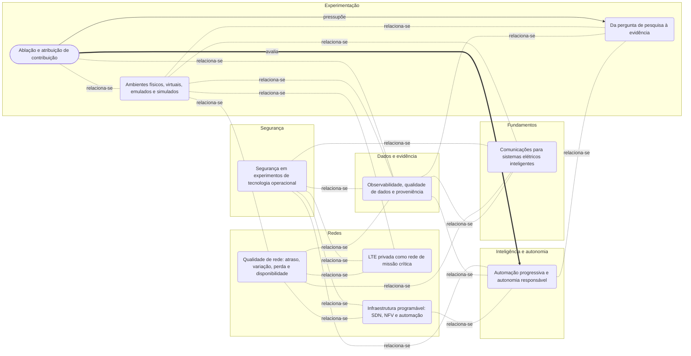

<!-- Gerado por docs/assets/src/render_concept_map.py a partir dos metadados das notas. Não editar manualmente. -->
# Mapa de conceitos

> Grafo das notas da base de conhecimento e de suas ligações tipadas. O mapa é
> derivado dos metadados de cada nota; para alterá-lo, edite a nota e regenere.

## Legenda

| Forma | Tipo de nota |
| --- | --- |
| contorno arredondado | Panorama de um domínio |
| retângulo | Conceito |
| cápsula | Método |
| retângulo de borda dupla | Tecnologia |

| Ligação | Leitura |
| --- | --- |
| `depends_on` — pressupõe | A pressupõe B: compreender A exige B. |
| `part_of` — parte de | A é componente de B. |
| `specializes` — é um tipo de | A é caso particular de B. |
| `evaluates` — avalia | O método A é usado para avaliar B. |
| `alternative_to` — alternativa a | A e B resolvem o mesmo problema por caminhos distintos. |
| `related` — relaciona-se | Relação fraca, sem semântica adicional. |

## Índice

| Nota | Tipo | Domínio | Resumo |
| --- | --- | --- | --- |
| [Comunicações para sistemas elétricos inteligentes](foundations/smart-grid-communications.md) | Panorama de um domínio | Fundamentos | Uma rede elétrica inteligente combina processos físicos, medição, computação, comunicação e decisão; a rede de comunicação é parte do sistema de controle, não apenas um meio de transporte de dados. |
| [Ablação e atribuição de contribuição](experimentation/ablation.md) | Método | Experimentação | Ablação estima a contribuição de um componente substituindo-o por um substituto de referência declarado, mantidas as demais condições do experimento. |
| [Ambientes físicos, virtuais, emulados e simulados](experimentation/experimental-environments.md) | Panorama de um domínio | Experimentação | O ambiente experimental determina quais mecanismos estão presentes, quais são representados por modelos e até onde uma conclusão pode ser generalizada. |
| [Da pergunta de pesquisa à evidência](experimentation/research-question-to-evidence.md) | Panorama de um domínio | Experimentação | Um experimento liga uma pergunta a uma conclusão por meio de condições declaradas, observações rastreáveis e critérios definidos antes da interpretação dos dados. |
| [Observabilidade, qualidade de dados e proveniência](data-and-evidence/observability-and-provenance.md) | Panorama de um domínio | Dados e evidência | Observar é produzir sinais sobre o sistema; confiar em uma conclusão exige também conhecer a qualidade, o contexto e a história desses sinais. |
| [Automação progressiva e autonomia responsável](intelligence/progressive-autonomy.md) | Panorama de um domínio | Inteligência e autonomia | Autonomia é uma capacidade avaliada por tarefa e cenário: observar, recomendar ou executar são níveis de autoridade diferentes e exigem evidências diferentes. |
| [Qualidade de rede: atraso, variação, perda e disponibilidade](networking/network-quality.md) | Panorama de um domínio | Redes | Qualidade de comunicação é a adequação mensurável da rede a uma função, sob condições e período definidos. |
| [LTE privada como rede de missão crítica](networking/private-lte.md) | Panorama de um domínio | Redes | Uma rede LTE privada oferece controle local sobre acesso, cobertura e políticas; sua adequação a uma função crítica precisa ser demonstrada de ponta a ponta. |
| [Infraestrutura programável: SDN, NFV e automação](networking/programmable-infrastructure.md) | Panorama de um domínio | Redes | Programabilidade transforma configuração e comportamento de rede em artefatos declarados, verificáveis e repetíveis, mas também amplia o impacto de erros. |
| [Segurança em experimentos de tecnologia operacional](security/defense-in-depth.md) | Panorama de um domínio | Segurança | Segurança experimental protege pessoas, processo físico, infraestrutura, dados e continuidade da pesquisa por meio de limites técnicos e organizacionais. |
